# WORK RANK ARCADE — Four Games 2D Motion & UX Remediation

Ngày kiểm chứng: **22/10/2026, Asia/Ho_Chi_Minh**. Báo cáo đặt trong thư mục `2026-10-21` theo đường dẫn yêu cầu. Phạm vi: Typing Battle, Computer Rush, Direction Rush, Memory Flash. Thực hiện trên mã local, chưa commit hoặc triển khai.

## Baseline

Baseline mới đã chơi thật 9 trận của ba arcade (Solo/Duo/Trio) và Typing Solo bằng Chromium. Các vòng sau chơi đủ 12 tổ hợp. Mỗi tổ hợp có nhiều browser context đăng nhập riêng, dùng HTTP và Socket.IO thật, không gán điểm vào UI.

- Typing cũ còn bố cục trang luyện gõ với khu thống kê/BXH; không có lane nhân vật, đích và podium chung. Đo CPU 4x: **56.4ms p95**, **21 long task**, **4,005 DOM nodes**, **214 React root commits**, **75.8ms frame p95**, CLS **0.00645**.
- Ba arcade đã có scene/cartoon từ lần cải tiến trước. Lần này cần đồng nhất HUD, âm thanh, podium và các phản ứng; Computer đổi từ quá tức thì; Direction chưa có cảnh báo 3–2–1 trước đảo chiều; Memory thiếu chuyển nấc rõ.
- Điểm dưới đây áp dụng rubric 11 mục của yêu cầu mới. Không so trực tiếp với điểm trong báo cáo ba game cũ có rubric khác.

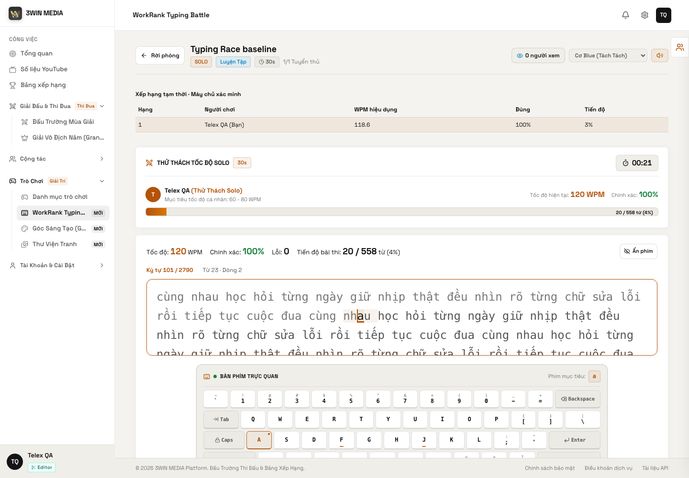
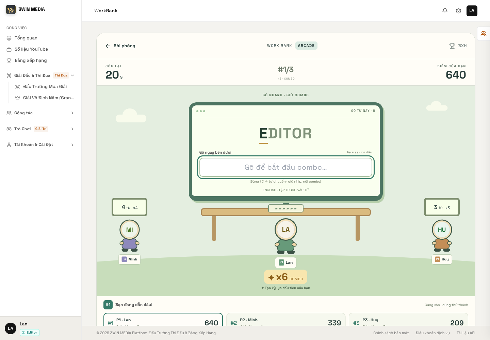
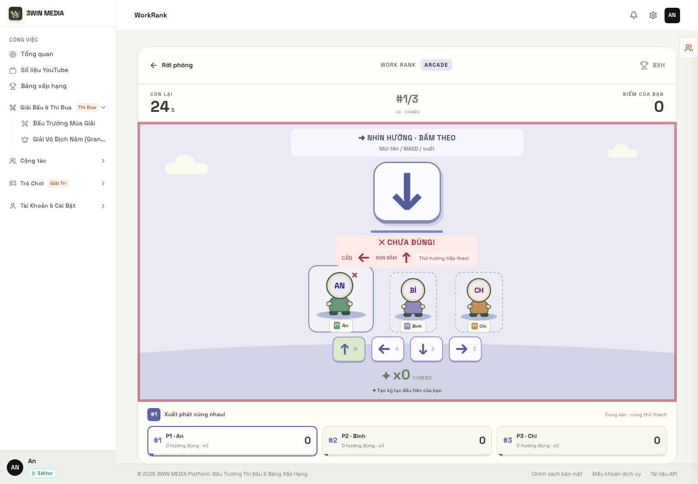
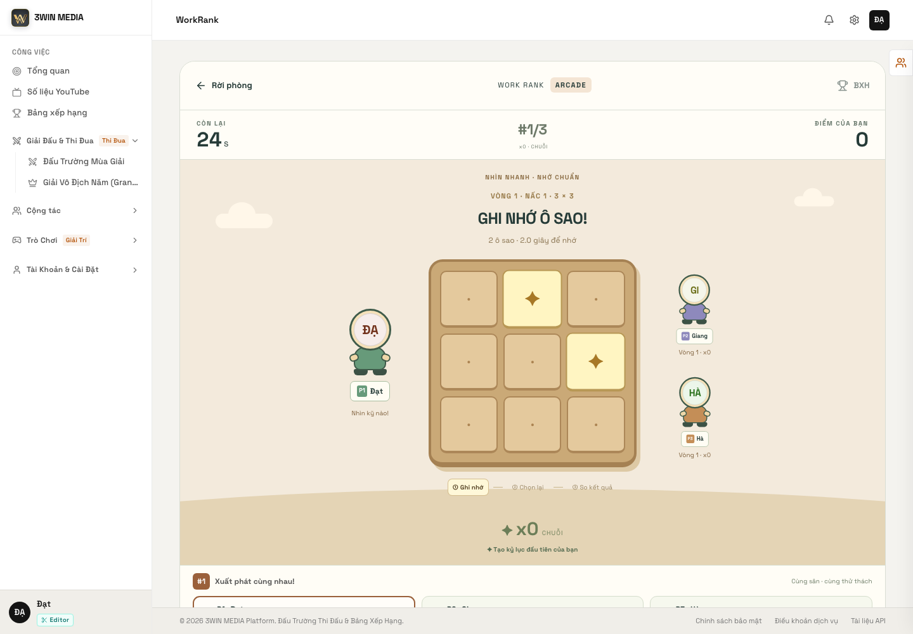

| Vòng | Typing | Computer | Direction | Memory |
|---|---:|---:|---:|---:|
| baseline | 6.32 | 8.79 | 8.88 | 8.89 |
| iteration1 | 8.75 | 9.15 | 9.22 | 9.15 |
| iteration2 | 9.04 | 9.22 | 9.29 | 9.26 |
| iteration3 | 9.17 | 9.22 | 9.29 | 9.26 |

Điểm là **tự đánh giá heuristic** sau thao tác, quan sát ảnh và số đo; không phải kết quả nghiên cứu người dùng độc lập. “Muốn chơi lại” phản ánh độ thuận tiện và sức hút qua playtest này; chưa chứng minh retention thực tế. Toàn bộ điểm từng vòng: [quality-rubric.json](four-games/quality-rubric.json).

## Shared Arcade Design System

Dùng DOM/CSS/SVG và component hiện có, không thêm thư viện. `ArcadeShared.jsx` cung cấp HUD, sound control, countdown và podium dùng thật ở cả bốn game. `PlayerAvatar2D` giữ cùng head/body/tỉ lệ, đổi màu nhận diện và state. `ArcadeResult` dùng chung cho ba arcade; Typing có phần thành tích WPM riêng nhưng dùng cùng podium và avatar.

- Typing Race: teal, đường đua, cờ đích, console giấy sáng ưu tiên đọc chữ.
- Computer Lab: xanh lá, màn hình, bàn, bàn phím, avatar local và màn hình/nhân vật đối thủ.
- Direction Arena: tím, arrow lớn, ba lane, accent cam khi luật đảo chiều active.
- Memory Room: màu mật ong, bảng ô sao, nhân vật cổ vũ bên cạnh/bên dưới theo kích thước màn hình.

Thứ bậc thống nhất: thời gian bên trái, hạng/combo giữa, điểm hoặc WPM bên phải. Mục tiêu, lỗi vừa xảy ra và trạng thái đối thủ nằm trong scene. Nút âm thanh có hit area 44px; preference dùng chung và giữ sau reload.

## Motion Tokens

Tuân thủ skill `smooth-motion` của dự án và token trong `index.css`; không tạo token mới.

| Nhóm | Token | Dùng cho |
|---|---|---|
| Micro | `--motion-instant` 100ms | Tay gõ, tile press/hide |
| Gameplay | `--motion-fast` 180ms | Jump/duck/dash, đúng/sai, word success/arrival, countdown beat |
| Progress | `--motion-normal` 260ms | Nội suy vị trí lane theo snapshot; không chặn input |
| Major | `--motion-layout` 340ms | Finish hop, podium/result, level-up |
| Chuyển nấc | `--motion-slow` 420ms | Thời gian hiển thị level-up |

260ms cho nội suy progress là ngoại lệ theo token sẵn có; phản ứng gameplay chính dùng 180ms. Easing dùng `--ease-standard`, `--ease-spring`, `--ease-exit`, `--ease-emphasized`. Chỉ chuyển động transform/opacity; kích thước bảng Memory cố định. Không có particle engine: dấu sao là pseudo-element, tự biến mất theo animation. Không có ambient animation chạy liên tục để lấy tài nguyên khi người chơi đang đọc/gõ.

`prefers-reduced-motion` và `html[data-workrank-reduce-motion="true"]` tắt chuyển động, giữ màu, dấu đúng/sai, combo, text và luật chơi. Listener/RAF/timer của component được cleanup khi unmount. Audio singleton và listener unlock sống cùng module ứng dụng.

## Character State Machine

`idle → ready → action → correct / wrong / combo → finish → win / lose`.

State biểu diễn bằng `data-state` trên `PlayerAvatar2D`, dùng chung phản ứng tay gõ, nhún đúng, khựng sai, sao combo, finish hop và tư thế podium. Direction thêm `data-direction` để UP nhảy, DOWN cúi, LEFT/RIGHT dash; không thêm physics engine. Rival nhận reaction theo snapshot và số attempts, không theo từng phím của đối thủ.

## Typing Battle 2D Redesign

Một UI path mới `TypingArcadeView`: practice, lobby Duo/Trio, arena, BXH và result. Đã xóa phần JSX dashboard/modal/keyboard cũ, helper tạo bài local và các state/handler UI không còn dùng; máy chủ cấp nội dung và xác minh kết quả. Xóa audio engine `typingSound.js` cũ, thay bằng singleton chung.

`TypingRaceTracks` memoized giữ các lane độc lập với input. Local runner lấy telemetry 10Hz, cập nhật transform trong RAF; lane không subscribe từng phím. Avatar tiến theo số ký tự đúng, khựng khi sai. Do passage là luồng dài, track dùng quãng đường hình ảnh chung tương đương120 WPM theo thời lượng, giới hạn94% khi chưa kết thúc; chỉ trạng thái kết thúc của server mới qua cờ. Đây là mapping visual, không thay progressPct/điểm thật; đối thủ nội suy snapshot khoảng 1s. Hoàn thành từ tăng combo, mốc 3/5/10/20 có phản ứng ngắn. Backspace hết lỗi trả trạng thái trung tính, không giữ nhãn sai.

Văn bản là vùng thao tác chính. `TypingPassage` chỉ mount block trước/hiện tại/kế tiếp, mỗi block 32 từ; toàn bộ nội dung vẫn nằm trong native input/session. Đo/scroll caret khi đổi từ hoặc resize, giảm layout read theo từng ký tự. DOM Solo từ 4,005 xuống 868 ở bài giống nhau.

Giữ native input, composition, NFC, Backspace, caret, session tăng dần, nháp và đồng bộ trì hoãn. Không chuyển keydown thành ký tự, không await network khi gõ. Kiểm tra riêng 620 ký tự đi qua nhiều block; typing offline rồi reload khôi phục 628 ký tự đầy đủ.

Duo/Trio có 2–3 lane rõ local/opponent, WPM/hạng, trạng thái về đích. Khi hết ván, avatar qua cờ và đợi 340ms trước podium; người đã xong không che nội dung của người còn chơi. Result có rank/WPM/accuracy/time/best combo và PB được máy chủ xác minh. Lượt practice ngắn không dựng PB giả.

Backend thêm mode TRIO, capacity 3, countdown 3s, individual ranking/winner và award có idempotency. Migration mở rộng enum giữ các mode cũ. Start yêu cầu đủ người/sẵn sàng. Reset chỉ host khi FINISHED, khóa transaction để ngăn double reset; giữ phòng/nhóm và tạo bài mới. Solo bấm Chơi lại tự vào đếm ngược; Duo/Trio giữ nhóm và chờ sẵn sàng. Đã kiểm tra sẵn sàng bằng nút UI của cả ba chế độ.

## Computer Rush Improvements

Success giữ từ vừa hoàn thành 180ms, fade/nhích lên rồi từ mới vào. Native input vẫn nhận chữ cho từ tiếp theo ngay; không có delay/disable để đợi animation. Nếu người gõ rất nhanh bắt đầu từ mới, UI ưu tiên hiển thị target mới. Tay avatar local hoạt động khi có draft, correct/wrong/combo dùng state chung. Rival monitor có số từ/combo và reaction theo snapshot. Giữ Unicode, composition, sửa lỗi và Enter bỏ qua.

## Direction Rush Improvements

UP jump và DOWN duck 180ms; LEFT/RIGHT dash, wrong stumble. Feedback lớn ghi **“VỪA RỒI: CẦN … / BẠN BẤM …”** để không nhầm với arrow của câu tiếp theo. Combo có trail ngắn.

Trước giai đoạn đảo chiều có cảnh báo **3 → 2 → 1 · Chờ biển cam!**. Chỉ cue có `opposite` thật từ engine mới đổi đáp án. Scene đổi accent và biển ĐẢO CHIỀU khi active. Ván 60s đã đi qua normal/position/color/entrance/opposite/final; thử bấm ngay lúc xoay, bấm hướng sai có chủ đích, sau đó bấm đáp án đảo đúng. Không mất 24 input liên tiếp dưới CPU 4x.

## Memory Flash Improvements

Ô sao reveal pop 180ms, hide toàn bảng đồng đều 100ms để không lộ vị trí; tap có press/depress, deselect thật. Review sai có đúng/x sai/★ bỏ sót trong 800ms. Board 304px mobile/328px desktop giữ khung khi từ 3×3 lên 4×4/5×5; ô 5×5 vẫn tối thiểu 44px.

Level-up 340ms, label 420ms thay đúng dòng tiêu đề đang có; trigger theo **board đang hiển thị**, sau review, nên không bị tiêu thụ khi board cũ vẫn còn trên màn hình. Difficulty thay từng biến; chơi tới vòng 19 và 5×5 dưới CPU 4x. Nhân vật không đè bảng ở Solo/Trio/mobile.

## Multiplayer Motion

Mỗi game đã chơi đủ Solo/Duo/Trio qua ba vòng cải tiến. Vòng 2 và 3 kiểm tra thêm quick replay giữ nhóm/chế độ, challenge mới và điểm/kỷ lục do server trả. Typing giữ cùng room; ba arcade tạo rematch room liên kết và giữ nhóm, không quay lại Game Center. Snapshot opponents không nằm trong critical path của input.

## Audio

Một `AudioContext` được prewarm lúc idle; 6 PCM buffer tạo một lần và tái sử dụng: correct, wrong, combo, countdown, start, finish. Action dùng BufferSource một lần theo Web Audio, tự disconnect; không dựng AudioContext/oscillator bank trong key handler. Rate-limit 85ms và bỏ cue khi muted/hidden/not-ready; không queue bù. Unlock có cooldown để không gọi resume IPC mỗi phím khi thiết bị audio chưa sẵn sàng.

Browser audit xác nhận **1 AudioContext**, đúng **6 buffer** được tạo trước và cue có BufferSource phát thật sau chuỗi nhập dài, điều hướng SPA qua cả bốn game; mute preference vẫn giữ. Chưa nghe kiểm định âm sắc trên loa thiết bị thật.

## Performance Before/After

Định nghĩa input-to-frame: từ capture listener của `input`/`keydown`/`click` tới RAF kế tiếp, bao gồm việc local update được xếp trước paint. Đây là proxy độ trễ tới frame, không phải hardware-to-photon hay Event Timing INP. React commits là **root commit toàn trang**, không phải số render riêng scene; thời gian sample giữa game khác nhau nên không so commit count như benchmark ngang hàng.

| Game / chế độ | p50 input→RAF | p95 input→RAF | RAF FPS trung bình | Frame p95 | Long task | React root commits | DOM ban đầu | CLS gameplay |
|---|---:|---:|---:|---:|---:|---:|---:|---:|
| Typing SOLO | 9.5ms | 11.3ms | 116.9 | 9.2ms | 0 | 156 | 868 | 0.00002 |
| Typing 1V1 | 10.1ms | 12.8ms | 115.0 | 9.3ms | 0 | 157 | 890 | 0.00002 |
| Typing TRIO | 10.4ms | 12.7ms | 110.6 | 16.1ms | 0 | 155 | 912 | 0.00002 |
| Direction Rush | 10.3ms | 15.6ms | 102.0 | 17.5ms | 0 | 496 | 361 | 0.00000 |
| Computer Rush | 5.2ms | 12.2ms | 98.1 | 18.1ms | 0 | 693 | 360 | 0.00000 |
| Memory Flash | 4.2ms | 6.0ms | 119.4 | 10.0ms | 0 | 1291 | 369 | 0.06749 |

Typing final lấy từ `four-games/final/typing-results.json` sau lượt kiểm tra sẵn sàng/replay bằng UI. Lượt bổ sung `final-race` kiểm tra Trio sau điều chỉnh quãng đường hình ảnh để các avatar tách nhau rõ trong bài có giới hạn thời gian: p95 **14.6ms**, RAF trung bình 110.6 FPS, 0 long task, 159 root commits, 912 DOM nodes, CLS 0.000015. Bảng trên giữ run final đủ ba chế độ để đối chiếu đồng nhất.

Typing: baseline 56.4ms → iteration1 Solo 27.1 / Duo 54.8 / Trio 50.2ms → iteration2 15.6/15.5/24.1ms → iteration3 10.1/14.5/16.5ms. Không kéo dài animation để che input lag; thay đổi lớn là passage windowing và giảm layout reads.

Ba arcade có reference CPU 4x từ lượt ba game trước: Computer 18.1ms, Direction 14.8ms, Memory 5.9ms; long task đều 0; CLS0/0/0.06029. Reference nằm ở `arcade-ux/final/device-performance-results.json`, **không phải paired baseline mới trong cùng run**. Baseline mới chỉ có gameplay/screenshot; không có số React commits/DOM/FPS mới cho ba arcade trước sửa và không điền số giả. Số raw tham chiếu được giữ nguyên.

Memory còn CLS khoảng0.06749 trong lần final đầu. Rect bảng không đổi kích thước; entries chủ yếu gắn với text/glyph thay đổi ở phase/tile, nhiều entry có previous/current rect bằng nhau. Chưa quy hoàn toàn nguyên nhân chỉ từ dữ liệu observer; đây là tồn tại cần theo dõi, không ghi là CLS0. Dưới ngưỡng0.1 của audit; không thấy board/target bị nhảy khi thao tác.

## Repeated CPU 4x Validation

Sau ba vòng cải tiến UI/game feel, chạy thêm đủ **ba lượt profile bản hoàn thiện** của ba arcade, mỗi lượt đều chơi ván 60s tới kết quả và replay, seed/thử thách mới. Các profile này kiểm độ ổn định bản cuối; không trình bày chúng như số đo hồi tố của source iteration1/2. Typing có profile riêng trong từng vòng và lần final.

| Game | Final đầu: p95 | Lặp 2: p95 | Lặp 3: p95 | Long task cả ba lượt |
|---|---:|---:|---:|---:|
| Computer Rush | 12.2ms | 13.0ms | 12.9ms | 0 |
| Direction Rush | 15.6ms | 12.1ms | 14.4ms | 0 |
| Memory Flash | 6.0ms | 5.0ms | 5.6ms | 0 |

Tổng **117 checks** của ba lượt đều PASS. Tất cả p95 tiếp tục dưới ngưỡng 25ms/20ms/25ms tương ứng; không mất 24 phím hướng mỗi lượt. Raw FPS/commits/DOM/CLS theo từng ván được giữ ở [lượt final](four-games/final/device-performance-results.json), [lặp 2](four-games/profile-loop-2/device-performance-results.json), [lặp 3](four-games/profile-loop-3/device-performance-results.json).

## CPU Throttle

Chromium CDP `Emulation.setCPUThrottlingRate=4`. Cả ba arcade profile đồng thời trong ba context; Typing profile host, đối thủ hoạt động trong context riêng. Harness trên máy này có RAF khoảng 120Hz; FPS trung bình là nhịp callback RAF, không chứng minh mọi thiết bị đạt120 FPS. CPU throttle không giả lập GPU yếu hoặc bàn phím vật lý. Các p95 hiện đáp ứng Typing/Computer≤25ms, Direction≤20ms và Memory≤25ms; tất cả sample không có long task≥50ms. Không kết luận mọi frame luôn≤16.7ms: Computer framep95 vẫn khoảng18ms.

## Mobile Review

390/430/768px đều có nhập/tap/vuốt thật trong browser, thêm1024/1440. Không chỉ screenshot. Tất cả kiểm tra tràn ngang đạt.

Typing ưu tiên passage, thu lane theo width. Khi visualViewport dưới550px, giữ lane local nhỏ và HUD, thu vùng text. Scroll chỉ `.app-main`, không cuộn ancestor `.arcade-scene` có overflow hidden (đã gây cắt lane ở vòng2). Sau reload, audit390×430 xác nhận marker/currentline và local lane trong viewport, sceneScroll0.

Computer thử gõ khi viewport390×430, input và target cùng trong màn hình. Direction thử swipe390, nút430, WASD/phím ở768. Memory chọn/bỏ chọn/sai, 5×5 trên390px CPU 4x, không lộ pattern ở SELECT.

**Giới hạn:** visualViewport/keyboard được mô phỏng trong Chromium, composition bằng sự kiện browser + nhập native. Chưa thao tác bàn phím hệ điều hành iOS/Android hoặc UniKey vật lý; cần kiểm tra trên thiết bị người dùng trước khi gọi là chứng nhận UniKey/mobile production.

## Iteration 1

Chơi 9 arcade + 3 Typing. Tạo shared HUD/countdown/podium/audio, race Typing và motion grammar. Computer success hold, Direction cảnh báo trước đảo chiều, Memory reveal/level-up. Typing đẹp hơn nhưng DOM vẫn 3,783–3,827 và p95 Duo/Trio~50ms; điểm input chưa đủ. Memory level-up còn xảy ra trong review cũ; cần trigger theo displayed board.

## Iteration 2

Chơi lại 12 tổ hợp và quick replay 9 arcade + 3 Typing. Window passage 32 từ/block, giữ ba block và chỉ track layout khi đổi từ. DOM 868/890/912; p95 Typing 15.6/15.5/24.1ms. Level-up sau review, finish crossing, mini lane ở bàn phím. Review screenshot 390 phát hiện lane đầu bị cắt vì `scrollIntoView` cuộn cả clipped ancestor; Mobile Typing chỉ 8.2 nên chưa chốt.

## Iteration 3+

Chơi lại 12 tổ hợp, quick replay và lượt final profiling sau cleanup. Sửa scroll container/visualViewport, giữ currentline+mini lane. Replay chờ HTTP ack, busy button và reset transaction guard. Dọn UI path/helper/audio cũ. Chạy riêng native/composition/NFD/Backspace, bài 620 ký tự, offline+reload 628 ký tự, reduced motion và audio singleton. Final 39 arcade checks và 7 native checks đều đạt. Lượt cuối Typing đã dùng nút sẵn sàng UI, xác nhận Solo Chơi lại tự STARTING và Duo/Trio giữ WAITING cùng nhóm. Bổ sung scale quãng đường race theo thời lượng và chạy lại Trio.

Điểm từng vòng, lỗi và screenshot được giữ trong `four-games/baseline`, `iteration1`, `iteration2`, `iteration3`, `final`; không ghi đè evidence của lượt ba game trước. Lần native đầu chờ chuỗi NFD byte-identical sau reload bị timeout; sửa assertion so NFC tương đương, giữ kiểm tra caret/input native và toàn bộ bản nháp. Lần rerun đạt; không thay source input để né IME. Counter BufferSource được lấy trước reload (reload tạo document/module mới); sau reload kiểm tra lại một context/sáu buffer và điều hướng SPA không tạo thêm context.

## Final Screenshots

Typing: Solo/midgame, Trio, wrong, finish, mobile và keyboard viewport:

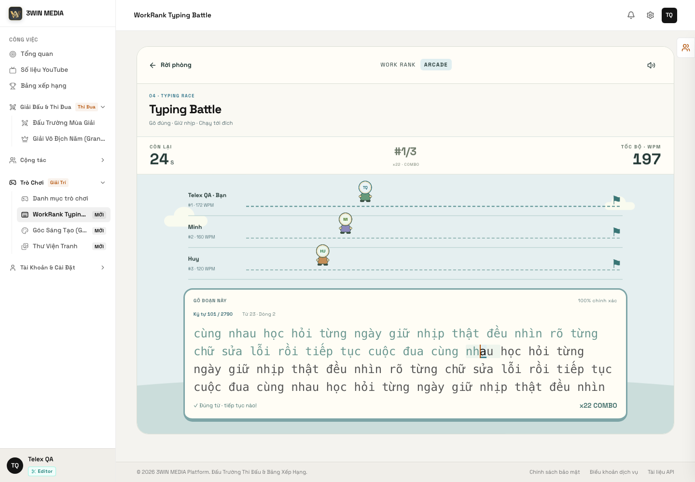
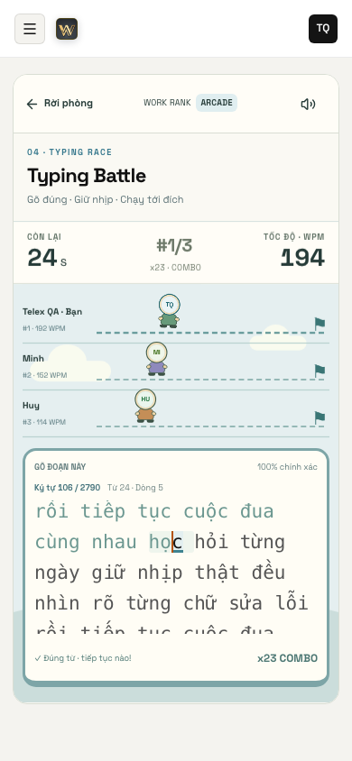
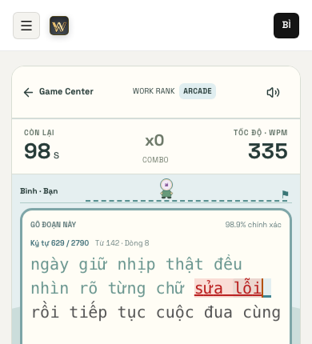
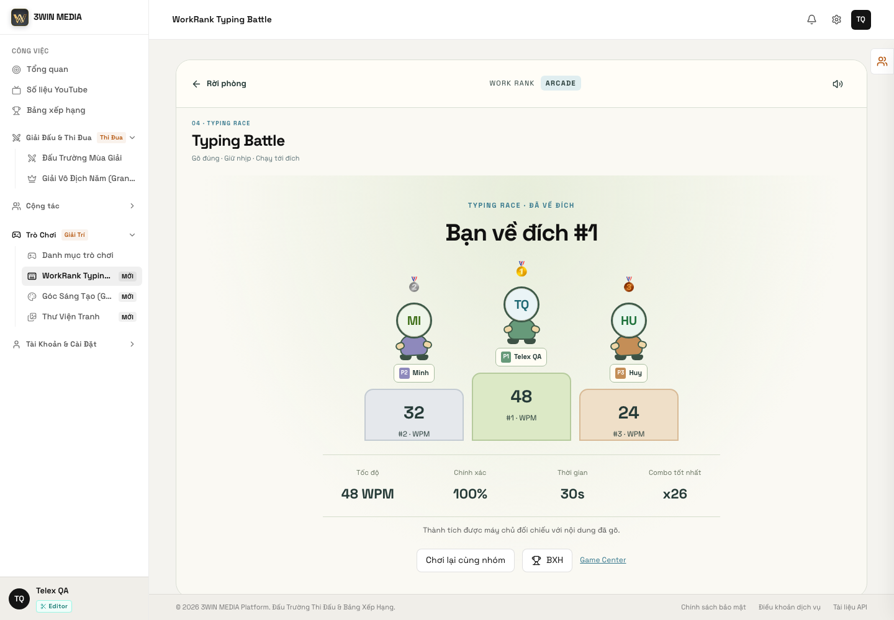

Computer: completion/Trio, combo và result:

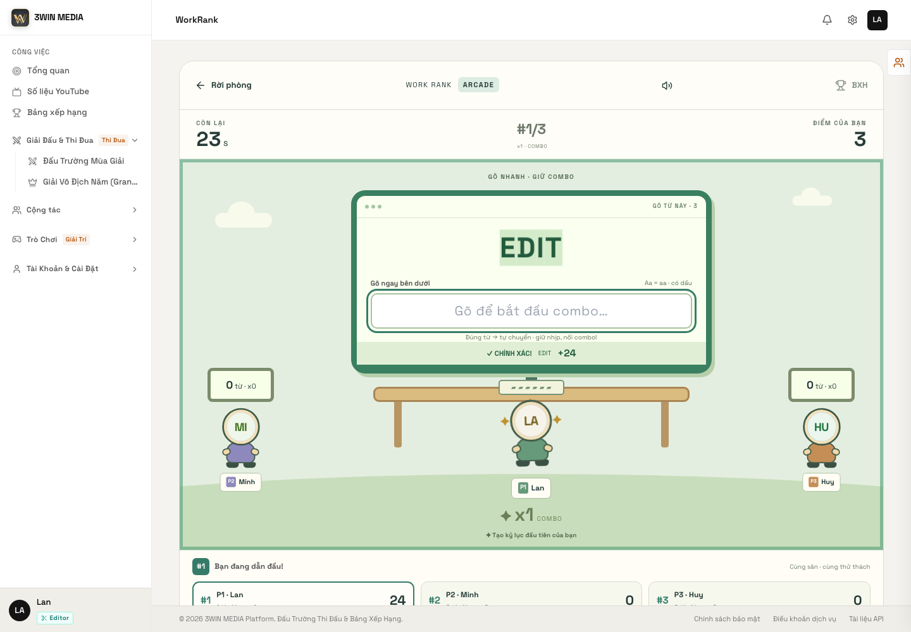
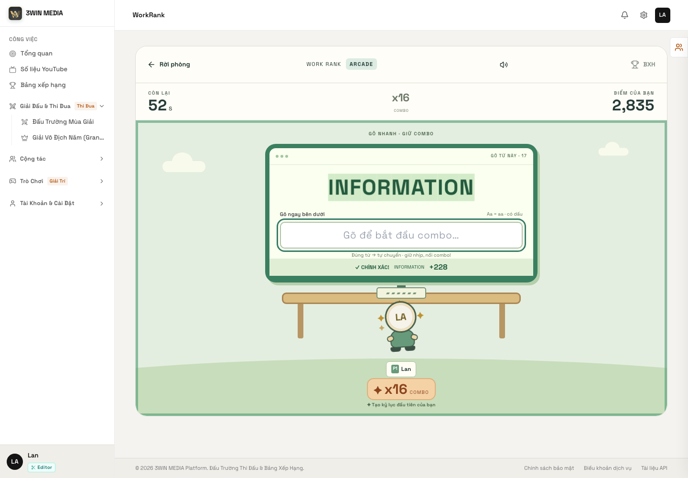
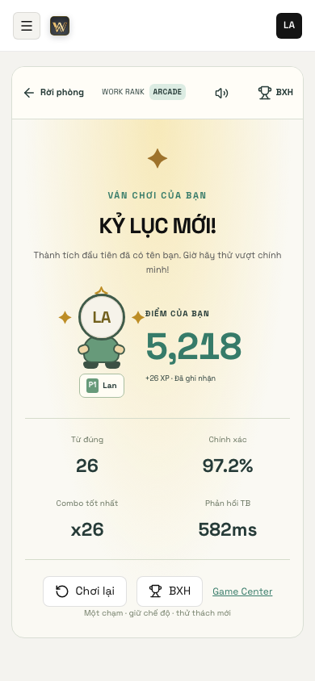

Direction: normal/wrong, cảnh báo, đảo chiều và mobile:

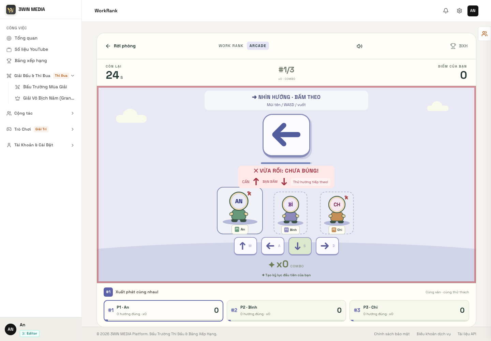
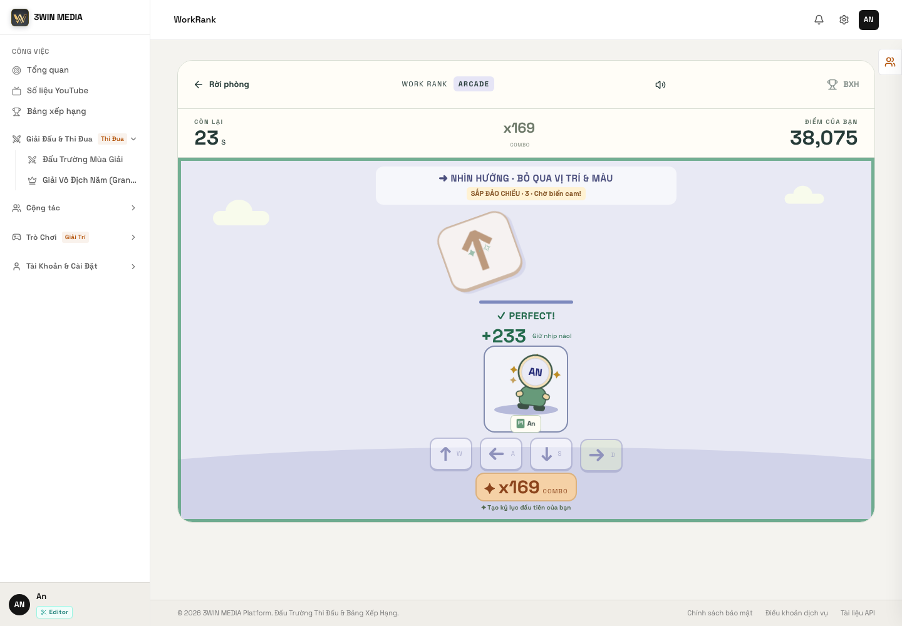
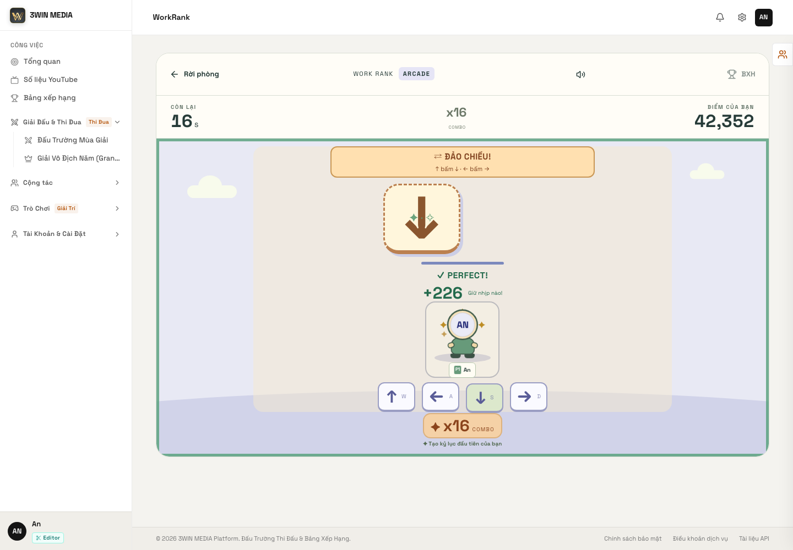
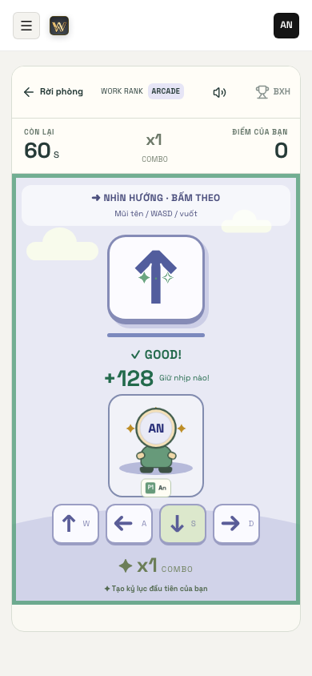

Memory: memorize/selection/wrong/5×5/Trio:

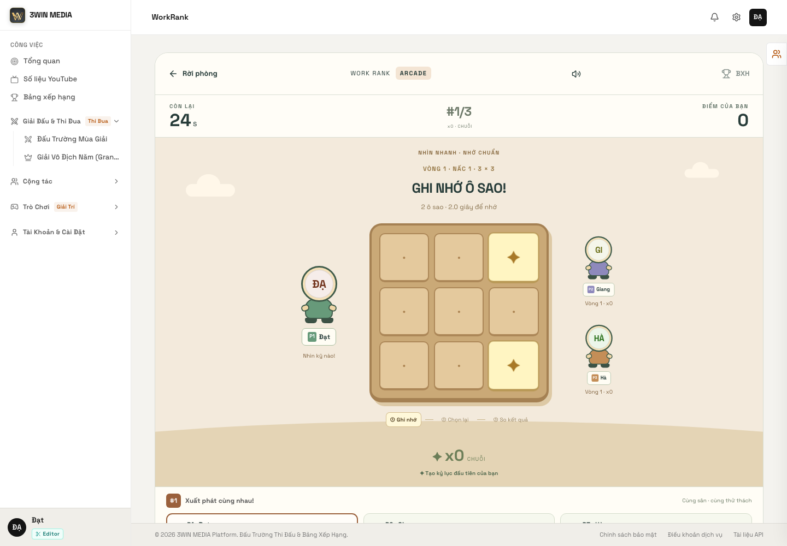
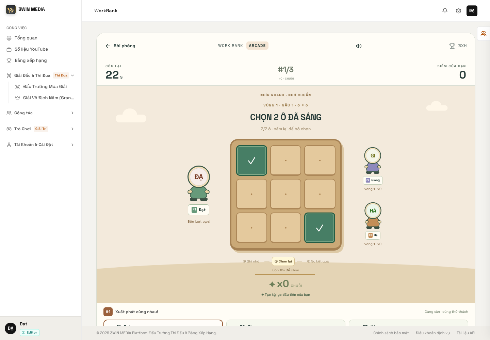
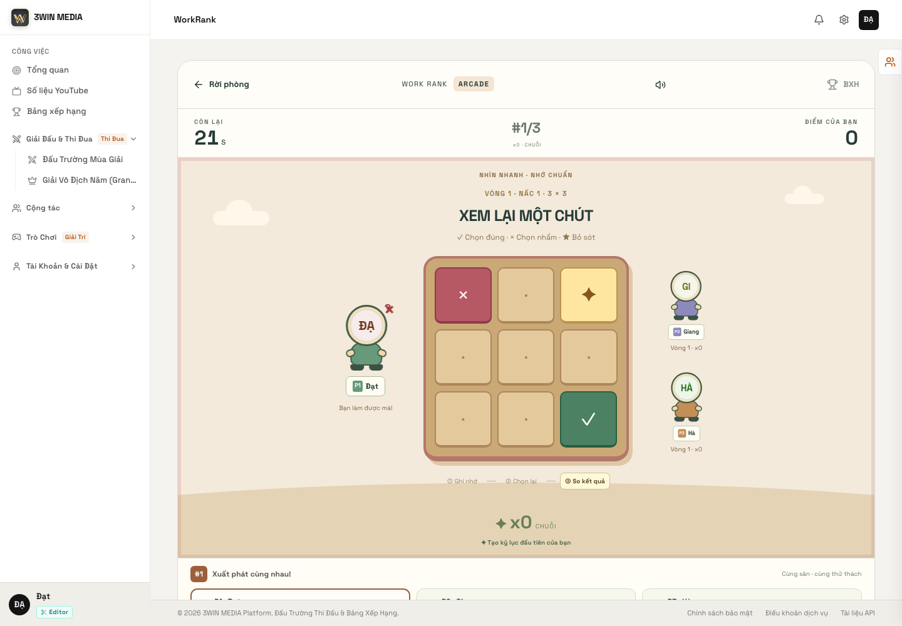
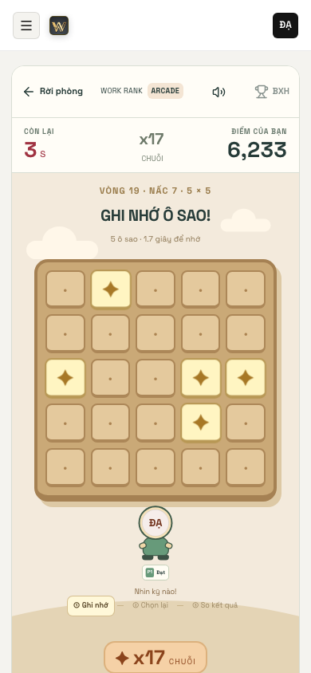

Các ảnh nêu trên đã mở để review: đọc chữ/arrow rõ, local lane khác đối thủ, palette chung nhưng scene riêng; target không bị nhân vật che. Các trạng thái còn lại có trong cùng thư mục và JSON playtest.

## Final Scores

| Tiêu chí | Typing | Computer | Direction | Memory |
|---|---:|---:|---:|---:|
| Visual identity | 9.2 | 9.2 | 9.1 | 9.2 |
| 2D scene quality | 9.1 | 9.2 | 9.2 | 9.2 |
| Animation smoothness | 9.2 | 9.3 | 9.4 | 9.3 |
| Correct feedback | 9.2 | 9.4 | 9.4 | 9.4 |
| Wrong feedback | 9.1 | 9.2 | 9.4 | 9.4 |
| Input responsiveness | 9.6 | 9.5 | 9.6 | 9.6 |
| Game feel | 9.2 | 9.3 | 9.3 | 9.3 |
| Multiplayer feel | 9.2 | 9.1 | 9.2 | 9 |
| Progression/pacing | 9 | 9 | 9.2 | 9.2 |
| Mobile | 9 | 9 | 9.2 | 9.1 |
| Replay desire | 9.1 | 9.2 | 9.2 | 9.2 |
| **Trung bình** | **9.17** | **9.22** | **9.29** | **9.26** |

Cả bốn trung bình≥9, không mục nào<8.5. Core UI/gamefeel/motion/input/multiplayer/replay đều tự đánh giá≥9 dựa trên evidence hiện có. Không biến số điểm này thành lời khẳng định người dùng thực tế chắc chắn đánh giá9+.

## Verification

- `frontend`: `npm run check` — PASS, 87 file, 0 integrity error.
- `frontend`: `npm run build` — PASS. Còn cảnh báo có sẵn về duplicate object keys ở Friends và CSS global `@media`; không phát sinh lỗi build.
- `backend`: `NODE_ENV=test node --import ./test/setup/teardown-db.mjs --test --test-concurrency=1 test/typing*.test.js test/arcade*.test.js` — **81/81 PASS**, 0 fail (~37s), gồm capacity/readiness/TRIO, ownership, award idempotency, reset concurrency và enum migration idempotency. Hai test cũ cập nhật để tất cả người chơi sẵn sàng trước start.
- Chromium: baseline 10 tổ hợp; mỗi iteration1/2/3 đủ 12; final 3 arcade 60s + Typing 3 chế độ, 39 device/gameplay/performance checks, 7 native/audio/recovery checks. Console `pageerror`:0 trong evidence giao cuối.
- `git diff --check` — PASS sau cleanup.

Tái chạy bằng server fixture SQLite `:memory:` trong `NODE_ENV=test`, PORT5112, `ARCADE_ROUND_SECONDS=24` cho vòng ngắn hoặc60 cho final; Vite5282 trỏ5112. Scripts: `four-games-typing-audit.mjs`, `four-games-native-audit.mjs`, `arcade-ux-playtest.mjs`, `arcade-ux-final-audit.mjs`. Set `UX_WEB`, `UX_API`, `UX_OUTPUT` cho ba arcade để không đè evidence khác. Typing scripts dùng loopback5112/5282. Chỉ fixture accounts, không sửa DB làm việc.

## Remaining Risks

1. Chưa kiểm chứng UniKey/OS keyboard và màn hình cảm ứng vật lý; browser automation không thay thế được bước này. Headless audio đã kiểm kiến trúc/mute, chưa review âm sắc trên loa thật.
2. Memory CLS không bằng0; cần theo dõi text/phase/glyph replacement dù board giữ kích thước. Các game đạt target p95 trong môi trường audit, không đảm bảo trên mọi thiết bị.
3. React commit count là root toàn trang, còn có ticktimer; không dùng số này để tuyên bố scene render 0 lần. Memo boundaries và sample 10Hz bảo đảm race không render nguyên scene theo từng phím.
4. Migration enum được kiểm fake MySQL idempotency và SQLite behavior; chưa chạy trực tiếp trên MySQL/Postgres production. Cần backup/quy trình deploy bình thường; chưa deploy trong công việc này.
5. Điểm cảm nhận là self-review. Cần người dùng thật kiểm chứng sức hút chơi lại, độ khó và công bằng của trick. Không có dữ liệu retention.

## Final Gates

| Gate | Kết quả |
|---|---|
| TYPING 2D SCENE | PASS |
| TYPING MOTION | PASS |
| TYPING INPUT SMOOTHNESS | PASS |
| TYPING MULTIPLAYER FEEL | PASS |
| TYPING FINAL SCORE | 9.17/10 |
| COMPUTER 2D SCENE | PASS |
| COMPUTER MOTION | PASS |
| COMPUTER GAME FEEL | PASS |
| COMPUTER FINAL SCORE | 9.22/10 |
| DIRECTION 2D SCENE | PASS |
| DIRECTION MOTION | PASS |
| DIRECTION FEEDBACK | PASS |
| DIRECTION TRICKS | PASS |
| DIRECTION FINAL SCORE | 9.29/10 |
| MEMORY 2D SCENE | PASS |
| MEMORY MOTION | PASS |
| MEMORY GAME FEEL | PASS |
| MEMORY FINAL SCORE | 9.26/10 |
| SHARED VISUAL CONSISTENCY | PASS |
| CHARACTER SYSTEM | PASS |
| HUD CONSISTENCY | PASS |
| PODIUM | PASS |
| REPLAY FLOW | PASS |
| MULTIPLAYER FEEL | PASS |
| MOBILE | PASS — browser interaction + viewport emulation; physical keyboard pending |
| PERFORMANCE | PASS — measured p95 targets; Memory CLS residual stated above |
| CPU 4X | PASS — tested browser/CPU environment |
| REAL BROWSER PLAYTEST | PASS |
| OVERALL 4-GAME ARCADE EXPERIENCE | PASS — heuristic acceptance, subject to physical-device/user-study limits |
