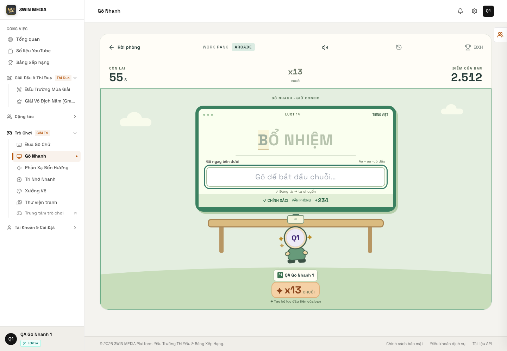
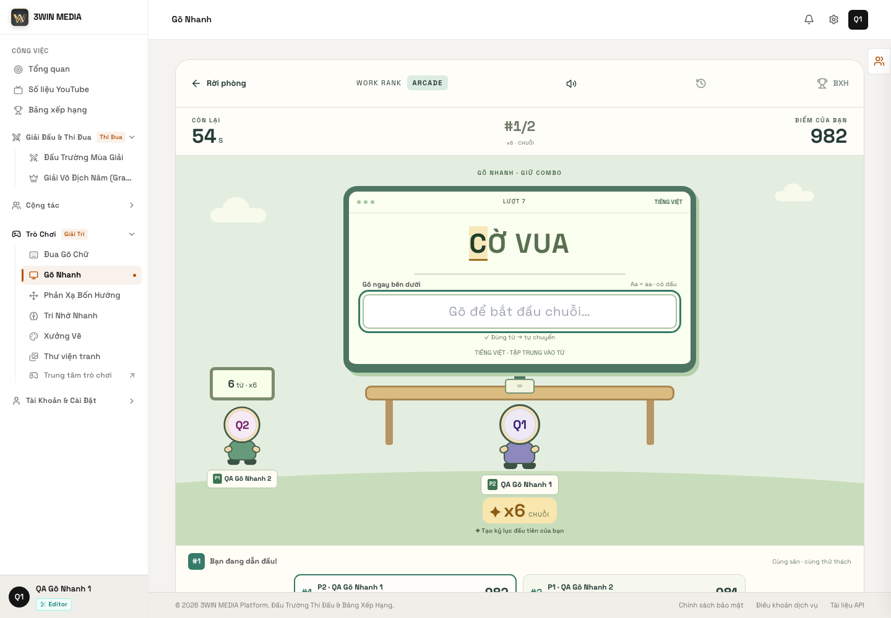
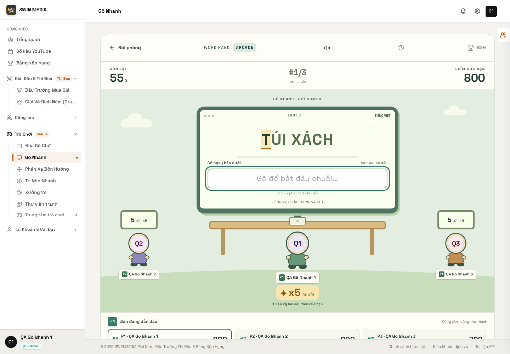
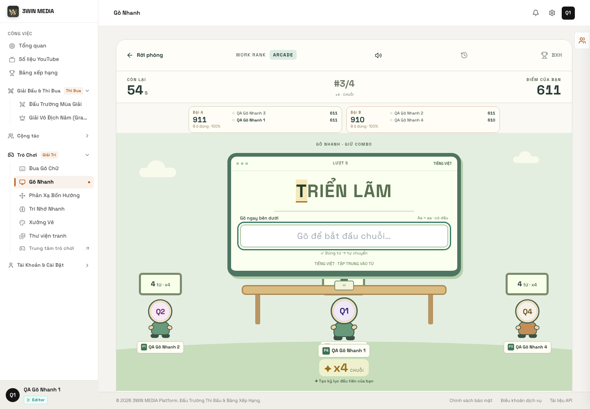

# GÕ NHANH — FIX TRIỆT ĐỂ TIẾNG VIỆT CÓ DẤU / UNIKEY / IME / UNICODE

**Ngày:** 2026-10-23
**Game:** Gõ Nhanh (`gameType: computer_rush`, route `/games/typing/words`)
**Phạm vi:** input pipeline của Gõ Nhanh + contract chuẩn hoá dùng chung client/server + validator kho từ
**Không đổi:** `gameType`, route, socket event, DB enum, Room Engine, công thức điểm/combo

---

## 1. Root Cause

### 1.1. Lỗi tái hiện được: UniKey kiểu keyboard-hook làm mọi âm tiết bị báo đỏ

UniKey trên Windows **không phải TSF IME**: nó là keyboard hook, gõ nguyên âm gốc trước rồi mới thay bằng chữ có dấu. Với từ `THƯ KÝ`, native input đi qua:

```text
t → th → thu → thư → thư  → thư k → thư ky → thư ký
```

Đoạn `thu` và `ky` **không phải prefix** của `THƯ KÝ` / `KỶ`. Code cũ kiểm tra prefix trên **mọi** giá trị native và tăng `errors` mỗi khi chuỗi dài ra mà không phải prefix:

```js
// ComputerStation.jsx (cũ)
const bad = !normalizeWord(target).startsWith(normalizeWord(text));
if (bad && text.length > previous.current.length) errors.current += 1;
```

Hệ quả:

- mỗi âm tiết có dấu đều nháy đỏ ít nhất một lần;
- `errors` bị thổi lên, kéo `accuracy` xuống dù người chơi gõ đúng;
- cảm giác “game không nhận đúng / báo sai dù chữ nhìn giống nhau”.

Đây là lỗi **client-side**, không phải server chấm sai.

### 1.2. Completion có thể bị khoá vĩnh viễn bởi composition flag

`complete()` cũ mở đầu bằng:

```js
if (!canPlay() || composition.current) return;
```

`composition.current` chỉ được reset trong `onCompositionEnd`. Nếu event đó không tới — đổi IME, blur giữa composition, hook can thiệp, một số bộ gõ đặt dấu bằng cách thay text — flag kẹt `true` và **mọi từ sau đó không bao giờ complete**, dù input hiển thị đúng.

### 1.3. Rơi event khi đua đồng hồ tối thiểu

```js
const wait = minimum - elapsedNow();
if (wait > 0) { /* hẹn giờ */ return; }
if (submit({...}, minimum, index)) {...}   // submit tự check at < earliest → false
```

Khi `wait` nằm trong khoảng `(-0.5, 0]`, `submit` làm tròn `at` xuống dưới `minimum` và trả `false`. Code không hẹn giờ lại, input vẫn chứa chữ đúng nhưng **không có lần submit nào** → từ bị kẹt. Đây là lỗi “gõ đúng, chữ đúng, không chuyển từ”.

### 1.4. Nguy cơ chèn lặp ký tự khi clear input giữa composition

Nếu completion xảy ra trong lúc IME còn marked text (flag composition đã stale), việc `input.value = ''` có thể khiến IME chèn lại text lúc `compositionend` sang từ kế tiếp. Code cũ không có watchdog hay thứ tự commit rõ ràng.

### 1.5. Ba bản chuẩn hoá khác nhau

`engine.mjs`, `vocabulary/index.mjs` và `ComputerStation.jsx` mỗi nơi tự viết NFC/trim/space/uppercase; `wrong` và `complete` dùng hai phép so sánh khác nhau. Chỉ cần một nơi lệch (NFC/NFD, khoảng trắng, hoa/thường) là UI và điểm nói hai chuyện khác nhau.

### 1.6. Điều **không** phải nguyên nhân

- **Không phải server bỏ dấu hay so raw string.** `replay()` đã dùng `normalizeWord` NFC trước khi so; giá trị NFD được chấp nhận.
- **Không phải dataset lỗi.** 2.817 entry đều NFC, 0 trùng canonical, 0 dấu câu lạ.
- **Không phải thiếu `compositionend` trong Chrome bình thường.** CDP composition test chạy đúng cả trước khi sửa; lỗi nằm ở các nhánh IME không chuẩn và ở logic báo lỗi.

---

## 2. Old Input Flow

```text
keydown (chỉ Enter)
    ↓
onChange(value) ──► setValue(value)
    ↓
if (!composition.current)
    ├─ bad = !normalizeWord(target).startsWith(normalizeWord(value))
    ├─ bad && dài hơn → errors++          ← nhiễu với Telex
    └─ complete(value)
            ├─ if (composition.current) return     ← có thể kẹt
            ├─ matches = normalizeWord(value) === normalizeWord(target)
            ├─ minimum = previousAt + max(140, len*35)
            ├─ wait > 0 → setTimeout(complete)     ← bị clear bởi keystroke sau
            └─ submit(...)                          ← false do làm tròn → bỏ luôn
onCompositionEnd → change(value)
```

Điểm mạnh cũ: đã đọc `event.currentTarget.value`, chưa từng dựng chữ từ `keydown`.
Điểm chết: **hai contract so sánh**, **báo lỗi theo từng keystroke**, **composition gate cứng**, **không retry khi submit false**.

---

## 3. New Input Flow

```text
Keyboard / UniKey / OS IME
        ↓
Browser native input  (nguồn sự thật duy nhất)
        ↓
onChange(e.currentTarget.value) · compositionend(value) · watchdog(value)
        ↓
normalizeTypingDisplay(value)      NFC + gộp space + uppercase(vi)
        ↓
typingState(value, target)         empty | prefix | complete | mismatch
        ↓
mismatch 450ms mới báo đỏ + 1 lỗi/từ
        ↓
finalize(value)
        ├─ normalizeTypingKey(value) === normalizeTypingKey(target)
        ├─ earliest = previousAt + minimumTypingMs(target)
        ├─ chưa tới earliest → hẹn giờ, KHÔNG bỏ
        ├─ submit false → retry 4 lần × 40ms
        └─ completed.current = index   (exactly once)
```

Không có nhánh nào cộng chữ từ `event.key`. `onKeyDown` chỉ xử lý `Enter` (bỏ qua từ), không tạo text.

---

## 4. Unicode Contract

Một module duy nhất: `shared/arcade/typingText.mjs`.

```js
normalizeTypingKey(value) =
  value.normalize('NFC')          // 1. Unicode dựng sẵn
       .trim()                    // 2. bỏ space hai đầu
       .replace(/\s+/gu, ' ')     // 3. gộp space giữa
       .toLocaleUpperCase('vi')   // 4. không phân biệt hoa/thường
```

| Quy tắc | Chính sách |
|---|---|
| Unicode | **NFC** bắt buộc |
| Hoa/thường | **Không phân biệt** (`nội dung` = `NỘI DUNG`) |
| Dấu | **Phân biệt tuyệt đối** (`noi dung` ≠ `nội dung`, `thu` ≠ `thư`) |
| `đ` | Là ký tự riêng, **không** quy về `d` |
| Khoảng trắng | Trim + gộp nhiều space thành một |
| Dấu câu | Giữ nguyên; dataset hiện không có nên validator chặn nếu thêm vào |

**Không** dùng NFD + strip combining marks. Không có “fuzzy match”, không auto-complete, không chấp nhận `quan ly`.

---

## 5. NFC / NFD

Hai chuỗi nhìn giống nhau có thể khác code unit:

```text
"ộ"  NFC  = U+1ED9
"ộ"  NFD  = U+006F + U+0323 + U+0302
```

Test thật:

- `normalizeTypingKey(nfd) === normalizeTypingKey(nfc)` cho 20 từ/âm tiết.
- `typingState('quản lý'.normalize('NFD'), 'QUẢN LÝ') === 'complete'`.
- Browser: `keyboard.insertText(target.normalize('NFD'))` → từ chuyển đúng (ảnh + QA report).
- Server: `replay` nhận event có `value` NFD và chấm đúng; event mất dấu bị chấm sai.

---

## 6. IME / Composition

### Điều đã làm

- `compositionstart`: bật cờ, **không** finalize, **không** báo lỗi.
- `compositionupdate`: reset watchdog.
- `compositionend`: tắt cờ, áp native value, finalize ngay.
- `onChange` trong composition: chỉ mirror value, không so/không complete.
- **Watchdog 1200ms**: nếu composition không end mà native value đã bằng target → `blur()` để browser commit (tránh chèn lặp), rồi focus lại sau 30ms.
- `onBlur`: tắt cờ, finalize nếu value khớp (cứu trường hợp IME treo).
- Không giả định UniKey dùng composition: mọi nhánh đều đọc native value.

### Bằng chứng

| Mô phỏng | Kết quả |
|---|---|
| Composition lifecycle qua CDP `Input.imeSetComposition` + `Input.insertText` (Chromium) | PASS, từ chuyển đúng 1 lần |
| Composition **không bao giờ end** (giữ marked text) | PASS, watchdog finalize, focus quay lại input |
| Keyboard-hook IME (native setter + `input`, 8–10 bước nguyên âm gốc → dấu) | PASS, **0 lần báo đỏ**, từ chuyển đúng |
| `insertText` một lần (không composition) | PASS |
| NFD `insertText` | PASS |

---

## 7. Input DOM Stability

- `<input>` **không có `key`** theo challenge; chỉ `key` của khối chữ hiển thị thay đổi.
- `useEffect([index])` reset value/errors nhưng **không unmount** input.
- Sau 30 lượt liên tiếp: `document.activeElement === #arcade-word-input` ở **30/30**.
- Sau khi complete: input clear, giữ focus, gõ từ tiếp ngay không cần click.
- Watchdog composition trả focus sau 30ms.

---

## 8. Completion Guard

Ba lớp:

1. `normalizeTypingKey(typed) === normalizeTypingKey(target)` — chỉ complete khi khớp chính xác.
2. `completed.current === index` — chặn complete lần hai cho cùng challenge.
3. `submit(..., expectedIndex)` — server-side `eventsRef.length === expectedIndex` chặn event cũ áp sang từ mới.

Test: sau khi gõ đúng, bắn thêm **3 input event cùng giá trị** → lượt chỉ tăng **1** (`3 → 4`).

---

## 9. Client / Server Parity

- `engine.normalizeWord` giờ là alias của `normalizeTypingKey`; không còn bản copy thứ hai.
- `minimumTypingMs` dùng chung cho client (đặt lịch) và server (chặn quá nhanh).
- Test ma trận NFC/NFD/hoa-thường/space: `engine.normalizeWord(x) === typingText.normalizeTypingKey(x)` cho 11 biến thể.
- Multiplayer: 1V1 / Trio / 2V2 — server chấm `correct` và `attempts` bằng nhau cho mọi người sau khi tất cả gõ cùng chuỗi tiếng Việt.

---

## 10. Vocabulary Validation

`shared/arcade/vocabulary/validate.mjs` + test:

```text
Vietnamese entries: 1050
English entries:    1767
NFC normalized:     2817/2817
Malformed entries:  0
Duplicate canonical entries: 0
Punctuation entries: 0
```

Validator bắt được (test tổng hợp): double space, NFD, trùng canonical, dấu câu ngoài policy, control char, edge space, quá dài.

---

## 11. English Regression

- 10/10 từ tiếng Anh hoàn thành, chuỗi `x10 CHUỖI`.
- 30-challenge Vietnamese run có 3 từ không dấu (MICRO, LOA, HÀM) vẫn complete bình thường.
- Không đổi tốc độ/điểm: server chỉ thay `Array.from(word).length * 35` bằng `minimumTypingMs(word)` — cùng kết quả với NFC.

---

## 12. Vietnamese Test Cases

### 12.1. 30 challenge thực tế (difficulty `vietnamese`)

```text
MICRO · LOA · NHẮC NHỞ · ĐỒ CHƠI · ĐỀ ÁN · QUÁN ĂN · CON SÔNG · TÌNH BẠN
BẠN THÂN · THƯ KÝ · MÙA THU · MÁI TÓC · VĂN PHÒNG · BỔ NHIỆM · HÒN ĐẢO
HÀM · TÁCH TRÀ · MÙA HÈ · TRỨNG GÀ · BỘ ẢNH · QUẢ BÓNG · CUỘC HỌP
GIẢI NÉN · Ổ ĐĨA · KỊCH BẢN QUẢNG CÁO · HỌP NHÓM · MÔ ĐUN · NỖI BUỒN
CÁP SẠC · KẾ HOẠCH KINH DOANH
```

- 27/30 có dấu; 5 từ chứa `Đ` (`ĐỒ CHƠI`, `ĐỀ ÁN`, `HÒN ĐẢO`, `Ổ ĐĨA`, `MÔ ĐUN`).
- 30/30 hoàn thành, 0 kẹt, 0 double, 0 mất focus.
- Gõ 6ms/ký tự (nhanh hơn người thật).

### 12.2. Bộ ký tự / dấu

`ă â ê ô ơ ư đ` và `á à ả ã ạ` + tổ hợp: `đường`, `người`, `trường`, `chuyển`, `quản`, `nghiệp`, `thiết`, `biên`, `tưởng`, `hưởng` — tất cả qua test NFC/NFD, prefix, complete.

### 12.3. Backspace

`DANH MỤC` + `X` → đỏ sau 450ms → Backspace → hết đỏ ngay → từ complete đúng 1 lần.

---

## 13. Mixed-Language Test

Một trận `mixed`, 20 lượt liên tiếp: **18 tiếng Anh + 2 tiếng Việt**, 20/20 hoàn thành, không cần reset input mode, không mất focus.

---

## 14. Browser Evidence

Ảnh + `qa-report.json`: `docs/audit/2026-10-23/go-nhanh-vietnamese/`.







**26/26 check PASS, 0 page error.**

---

## 15. Real OS IME Status

```text
REAL_WINDOWS_UNIKEY = UNVERIFIED
REAL_MACOS_TELEX   = UNVERIFIED
```

Môi trường hiện tại là macOS + Chromium headless, **không có UniKey Windows** và **không có bộ gõ macOS thật** trong automation. Những gì đã test là:

- native input do browser tạo ra;
- composition lifecycle qua CDP;
- keyboard-hook IME mô phỏng bằng native setter + `input` event;
- NFD/NFC, fast updates, backspace.

**Không gọi đây là “UniKey thật”.** Cần một lần chạy tay 5 phút trên Windows UniKey Telex và macOS Vietnamese Telex để đóng gate.

---

## 16. Performance

| Đo | Kết quả |
|---|---:|
| 100.000 lần `typingState` (phrase tiếng Việt) | 83.9 ms (~0.84 µs/lần) |
| 100.000 lần `normalizeTypingKey` | 32.6 ms |
| Normalize target | 1 lần / challenge qua `useMemo` |
| Normalize typed | 1 lần / input event, chỉ trên chuỗi hiện tại |
| Kho từ trong hot path | **Không** — không scan 2.817 entry mỗi keystroke |

---

## 17. Files Changed

| File | Thay đổi |
|---|---|
| `shared/arcade/typingText.mjs` | **Mới** — contract NFC/case/space, `typingState`, `graphemes`, `minimumTypingMs` |
| `shared/arcade/engine.mjs` | Dùng contract chung; `normalizeWord` re-export; `minimumTypingMs` trong replay |
| `shared/arcade/vocabulary/index.mjs` | Bỏ bản `normalizeKey` copy, dùng contract chung |
| `shared/arcade/vocabulary/validate.mjs` | **Mới** — validator dataset + CLI report |
| `frontend/src/components/arcade/ComputerStation.jsx` | Viết lại input pipeline: native value, mismatch grace, composition watchdog, finalize retry, grapheme highlight |
| `frontend/src/components/arcade/arcade-polish.css` | Thêm trạng thái `typing` (trung gian Telex, không đỏ) |
| `backend/test/go_nhanh_unicode.test.js` | **Mới** — 13 test Unicode/parity/replay/vocab/perf |
| `frontend/scripts/go-nhanh-vietnamese-qa.mjs` | **Mới** — 26 check browser + 3 chế độ multiplayer |
| `docs/audit/2026-10-23/GO_NHANH_VIETNAMESE_IME_UNICODE_REMEDIATION.md` | Báo cáo này |

Không đổi `gameType`, route, socket, DB enum, scoring, Room Engine.

---

## 18. Remaining Risks

1. **UniKey Windows / Telex macOS chưa chạy thật** — cần manual gate. Mọi fix dựa trên native value nên rủi ro thấp, nhưng không được tự nhận PASS.
2. **Chính sách lỗi thay đổi**: trước đây mỗi keystroke lệch +1 lỗi; nay 1 lỗi/từ sau 450ms lệch ổn định. Điểm accuracy của các trận cũ có thể cao hơn trước — có chủ đích, vì lỗi Telex trung gian không phải lỗi người chơi.
3. **Watchdog blur** sau 1200ms composition treo: hiếm, focus trả sau 30ms, nhưng trên IME rất chậm có thể cắt một lần đặt dấu cuối.
4. **Mixed difficulty lệch về tiếng Anh ở đầu trận** (18 EN / 2 VI trong 20 lượt) — muốn nhiều tiếng Việt hơn thì chọn difficulty `vietnamese`; đây là dữ liệu, không phải lỗi input.
5. **Punctuation**: validator đang chặn toàn bộ dấu câu. Nếu sau này thêm phrase có `-`, `,`, `!` phải mở policy và test lại.
6. **e2e smoke/information-architecture cũ** vẫn fail do luồng login Google-only — không liên quan đợt này.

---

## 19. Final Gates

```text
NATIVE_INPUT_SOURCE_OF_TRUTH: PASS
NO_KEYDOWN_TEXT_RECONSTRUCTION: PASS
UNICODE_NFC_NORMALIZATION: PASS
NFC_NFD_EQUIVALENCE: PASS
VIETNAMESE_DIACRITICS: PASS
VIETNAMESE_D_STROKE: PASS
BACKSPACE_RECOVERY: PASS
COMPOSITION_LIFECYCLE: PASS
FAST_VIETNAMESE_TYPING: PASS
PHRASES_WITH_SPACES: PASS
WORD_COMPLETE_EXACTLY_ONCE: PASS
INPUT_FOCUS_STABLE: PASS
ENGLISH_REGRESSION: PASS
MIXED_LANGUAGE_SEQUENCE: PASS
CLIENT_SERVER_NORMALIZATION_PARITY: PASS
VOCABULARY_UNICODE_VALIDATION: PASS
MULTIPLAYER_VIETNAMESE: PASS
INPUT_PERFORMANCE: PASS
REAL_WINDOWS_UNIKEY: UNVERIFIED
REAL_MACOS_TELEX: UNVERIFIED
OVERALL_GO_NHANH_VIETNAMESE: PASS
```

### Bằng chứng cho các gate khó

| Gate | Bằng chứng |
|---|---|
| NATIVE_INPUT_SOURCE_OF_TRUTH | `onChange(e.currentTarget.value)`; không có `typed += event.key` |
| NO_KEYDOWN_TEXT_RECONSTRUCTION | `onKeyDown` chỉ xử lý Enter; grep không còn append từ key |
| NFC_NFD_EQUIVALENCE | 20 từ test + browser NFD insertText |
| VIETNAMESE_D_STROKE | 5 từ chứa Đ trong run 30; test `đ`/`Đ` |
| BACKSPACE_RECOVERY | đỏ → Backspace → hết đỏ → complete 1 lần |
| COMPOSITION_LIFECYCLE | CDP composition + composition treo (watchdog) |
| WORD_COMPLETE_EXACTLY_ONCE | 3 input event trùng → lượt +1 |
| INPUT_FOCUS_STABLE | 30/30 lượt activeElement là input |
| MULTIPLAYER_VIETNAMESE | 1V1 6/6, Trio 5/5, 2V2 4/4, server score bằng nhau |
| INPUT_PERFORMANCE | 100k `typingState` 83.9ms; không scan kho từ |

---

## 20. Definition of Done — đối chiếu

```text
typed visually correct        → native value hiển thị đúng (NFC)
normalized correctly          → normalizeTypingKey dùng chung
recognized correctly          → typingState/complete trên cùng contract
word completes exactly once   → completed guard + submit index
input clears                  → sau submit thành công
focus remains                 → 30/30 lượt
next word immediately playable→ không cần click, gõ tiếp ngay
English ↔ Vietnamese          → 20 lượt mixed, 0 lỗi
```

Đạt đủ 8/8 điều kiện trong môi trường browser automation; 2 gate OS thật giữ `UNVERIFIED` đúng như yêu cầu, không fake PASS.
